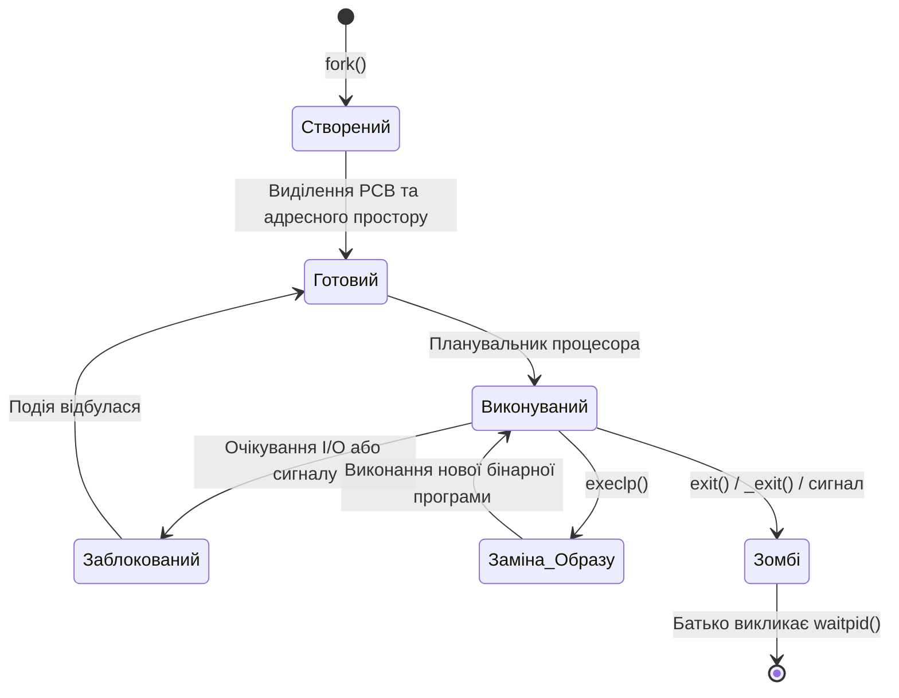

# Лабораторна робота №3. Керування життєвим циклом процесів у C/Linux

**Предмет:** Операційні системи  | **Група:** ІПЗ-41  | **Виконала:** Єва Якимчук

---

## 1. Мета роботи
Дослідити системні механізми створення нових процесів за допомогою системного виклику `fork`, заміни образу виконуваного процесу функціями родини `exec` (`execlp`), синхронізації та очікування завершення через `waitpid`, а також навчитися аналізувати статус завершення дочірніх процесів за допомогою макросів `WIFEXITED`, `WEXITSTATUS`, `WIFSIGNALED` та `WTERMSIG`.

---

## 2. Теоретичні основи життєвого циклу процесів



1. **`fork()`** клонує поточний процес, створюючи копію його віртуальної пам'яті (за механізмом Copy-On-Write), дескрипторів та регістрів:
   * Батькові повертається **PID нащадка** ($> 0$).
   * Дочірньому процесу повертається **0**.
   * У разі збою повертається **-1**.
2. **`execlp()`** замінює поточний сегмент коду, даних, стека та купи процесу новою виконуваною програмою, зберігаючи при цьому той самий PID та більшість відкритих файлових дескрипторів. У разі успіху керування у вихідну програму ніколи не повертається.
3. **`waitpid(pid, &status, options)`** блокує батька до зміни стану нащадка і збирає інформацію про код повернення, запобігаючи накопиченню процесів-зомбі (Zombie processes).

---

## 3. Виконання завдань та аналіз результатів

### Завдання 1. Програма `process_demo.c`
Компіляція та запуск:
```bash
gcc -Wall -Wextra -pedantic -o process_demo process_demo.c
./process_demo
```
* **Типовий результат виконання:**
```
Батько: pid=12401, ppid=3450
Нащадок: pid=12402, ppid=12401
Нащадок запустив команду echo
Батько: нащадок завершився з кодом 0
```
* **Аналіз:** Батько успішно дочекався завершення нащадка, макрос `WIFEXITED(status)` повернув `true`, а `WEXITSTATUS(status)` повернув `0` (успіх утиліти `echo`).
* **Роль `fflush(NULL)`:** Якщо перед викликом `fork()` у буфері стандартного виводу користувача залишалися нескинуті дані, вони скопіювалися б у дочірній процес, і текст надрукувався б двічі. Виклик `fflush(NULL)` примусово скидає всі буфери потоків до клонування.

### Завдання 2. Модифікація та імітація збою запуску
* **Запуск `ls -l`:** Після заміни `execlp` нащадок виводить лістинг поточного каталогу з детальними атрибутами файлів, після чого батько фіксує успішне завершення з кодом `0`.
* **Запуск неіснуючої програми `no-such-program-xyz`:**
  * Виклик `execlp` повертає `-1` через помилку `ENOENT` (No such file or directory).
  * Спрацьовує `perror("execlp")`, виводячи діагностичне повідомлення в `stderr`.
  * Дочірній процес викликає `_exit(127)`.
  * Батько фіксує: `Батько: нащадок завершився з кодом 127` (стандартний код завершення для позначення відсутності команди в POSIX/Bash).

### Завдання 3. Програма `worker_children.c` (Множинні нащадки)
Компіляція та запуск:
```bash
gcc -Wall -Wextra -pedantic -o worker_children worker_children.c
./worker_children
```
* **Отриманий результат:**
```
Нащадок 0: код завершення 10
Нащадок 1: сигнал 6
Нащадок 2: код завершення 12
```
* **Пояснення:**
  * Нащадок 0 викликав `_exit(10)` $\to$ `WIFEXITED` повернув `true`, код завершення `10`.
  * Нащадок 1 викликав `abort()` $\to$ процес був примусово перерваний генерацією сигналу `SIGABRT` (числовий номер сигналу у Linux дорівнює **6**). Макрос `WIFSIGNALED` повернув `true`, а `WTERMSIG` зафіксував сигнал `6`.
  * Нащадок 2 викликав `_exit(12)` $\to$ код завершення `12`.
  * Батьківський процес викликає `waitpid(pids[i], ...)` послідовно у строгому порядку масиву ($0 \to 1 \to 2$), тому звіт завжди виводиться в однаковій послідовності незалежно від мікросекундних коливань планувальника.

---

## 4. Відповіді на питання для захисту

1. **Що повертає `fork` батьківському процесу, а що — нащадкові?**
   * Батьківському процесу `fork()` повертає числовий `PID` (ідентифікатор) новоствореного нащадка ($> 0$), щоб батько міг керувати ним та очікувати його завершення.
   * Дочірньому процесу `fork()` повертає число `0`, що є маркером виконання всередині новоствореного процесу.
   * У разі помилки створення (наприклад, вичерпано ліміт процесів `EAGAIN`) повертається `-1`.

2. **Чому після успішного `exec` код, що йде далі, не виконується?**
   Тому що системний виклик `exec` повністю замінює образ пам'яті поточного процесу (сегменти тексту програми, даних, купи та стека) новою виконуваною програмою з диска. Лічильник команд (Instruction Pointer) скидається на точку входу (`main`) нової бінарної програми, а старий програмний код більше фізично не існує в адресному просторі. Код після `exec` спрацьовує виключно тоді, коли виклик зазнав невдачі.

3. **Що повертає `waitpid` і що містить змінна `status`?**
   * `waitpid` повертає `PID` дочірнього процесу, чий стан змінився, або `-1` у разі помилки (наприклад, немає таких дочірніх процесів `ECHILD`).
   * Цілочисельна змінна `status` містить упаковану бітову маску ядра Linux, у якій закодовано: причину завершення (нормальний вихід чи сигнал), молодші 8 біт коду повернення (`exit status`), номер сигналу, що спричинив переривання, та прапорець генерації дампу пам'яті (Core Dump).

4. **Чим відрізняється нормальне завершення процесу від завершення сигналом і як це визначити макросами `WIFEXITED` / `WIFSIGNALED`?**
   * **Нормальне завершення:** процес добровільно завершив роботу, виконавши `return` з функції `main` або виклик `exit(code)` / `_exit(code)`. Макрос `WIFEXITED(status)` повертає ненульове значення (істину), а макрос `WEXITSTATUS(status)` витягує числовий код завершення ($0..255$).
   * **Завершення сигналом:** процес було аварійно знищено ядром через отримання неперехопленого або неблокованого сигналу (наприклад, `SIGSEGV` через помилку пам'яті, `SIGABRT`, `SIGKILL`). Макрос `WIFSIGNALED(status)` повертає істину, а макрос `WTERMSIG(status)` повертає числовий номер цього сигналу (наприклад, 6 для `SIGABRT` або 9 для `SIGKILL`).

---

## 5. Висновок
У лабораторній роботі опановано керування життєвим циклом процесів в ОС Linux. Реалізовано канонічну тріаду `fork` $\to$ `exec` $\to$ `waitpid`, детально досліджено механізм аналізу бітових статусів завершення та відмінності між штатною зупинкою процесу і фатальним перериванням апаратними/програмними сигналами.
